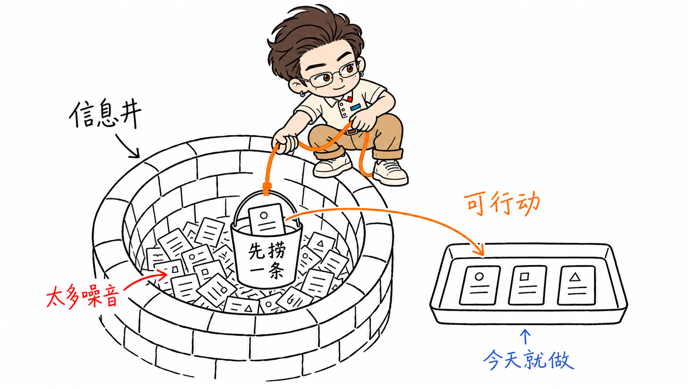
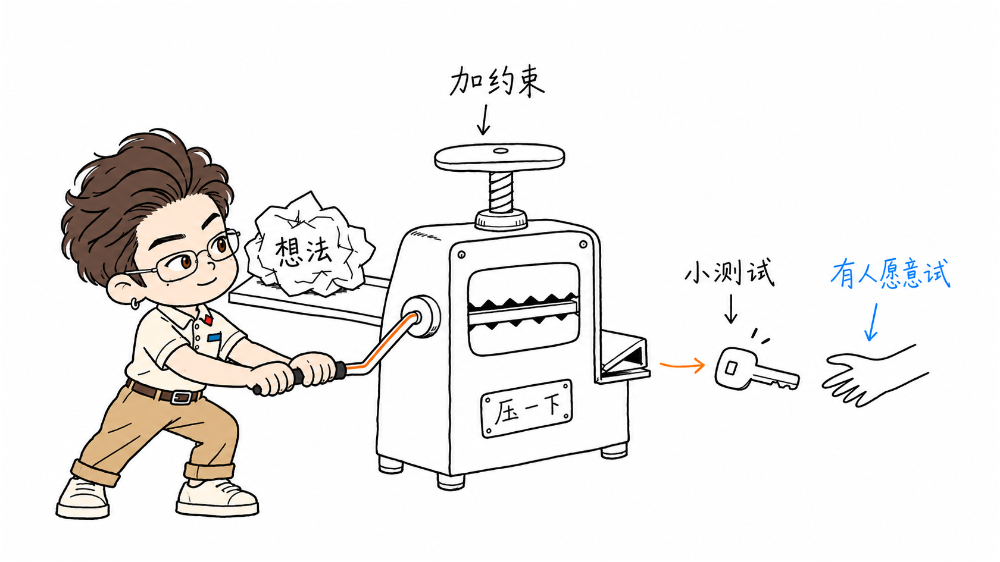

# jason 手绘正文配图

把中文文章里值得解释的一句话画出来。jason 在画面中亲自举、拉、递、接或转动道具，用动作说明观点。人物和场景都用二维墨线，人物暖色平涂，背景纯白。

## 直接使用

```text
用 $jason-illustrations 给这篇文章生成 3 张手绘正文配图。每张对应一个关键段落，并告诉我插在哪里。

[粘贴正文]
```

只想先选配图位置，可以说“先给配图清单”。也可以给一个观点直接生成单图，或附上已有图片要求改字、调整动作。成图按内容逐张交付，默认保存到当前文章工作区的 `assets/<article-slug>-illustrations/`。[更多调用示例](examples/prompts.md)

## 已确认的三张样图

| 01 两个断点 | 05 信息井 | 06 想法压机 |
| --- | --- | --- |
|  |  |  |
| 同一角色在两个位置的识别度 | 蹲姿、握绳和提桶动作 | 人物与场景的手绘主参考 |

三张样图均为 1680 × 945 像素。新文章用自己的主题、道具和短词构图。默认人物戴透明细框眼镜、穿奶油色短袖与暖卡其裤，也支持浅琥珀镜片和驼色夹克。[角色定义](references/jason-ip.md) · [生图与改图 Prompt](references/prompt-template.md)

## 安装到 Codex

首次安装时，把仓库直接克隆到 Codex 的个人技能目录，文件夹名使用 `jason-illustrations`。

```sh
mkdir -p "${CODEX_HOME:-$HOME/.codex}/skills"
git clone https://github.com/daijiazhen/Self-Ipimage.git "${CODEX_HOME:-$HOME/.codex}/skills/jason-illustrations"
```

在新对话中输入 `$jason-illustrations` 即可调用。用上述命令安装后，可运行下面的命令更新。手动安装时，将含有 `SKILL.md` 的整个目录复制到同一位置，保留参考图和模板的目录结构。[Skill 入口](SKILL.md)

```sh
git -C "${CODEX_HOME:-$HOME/.codex}/skills/jason-illustrations" pull --ff-only
```

本 Skill 改编自 Ian 的 *Ian Xiaohei Illustrations*。本版的 jason 人设来自用户提供的参考图，三张示例按确认过的手绘画法重新绘制。[上游版本](https://github.com/helloianneo/ian-xiaohei-illustrations/tree/8961915fcdbca57f288ec52b173056501d8a87f2) · [署名说明](NOTICE.md) · [上游许可](LICENSE)
